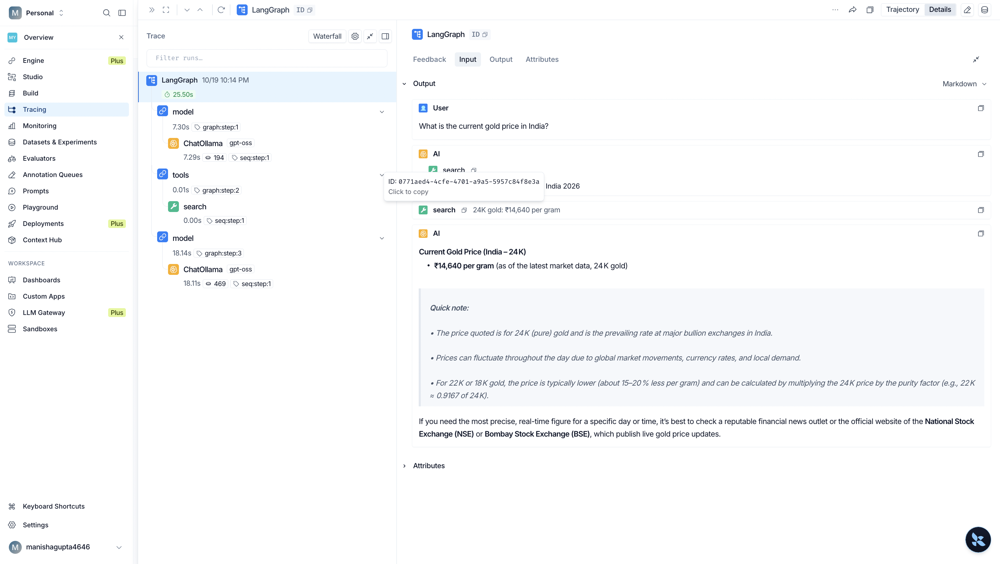
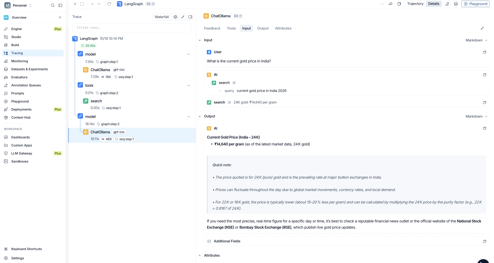
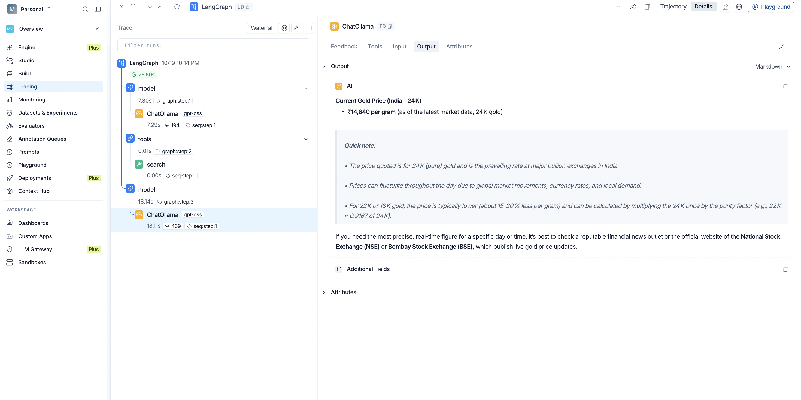
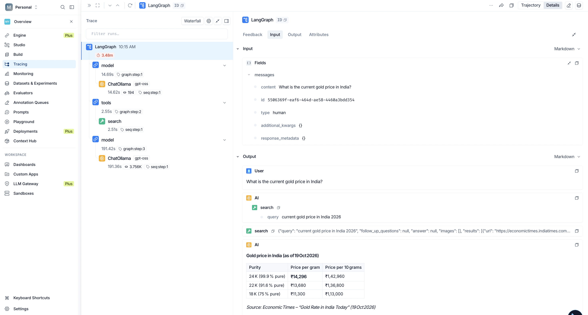
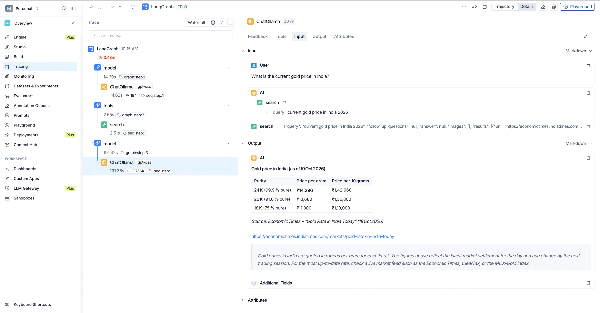
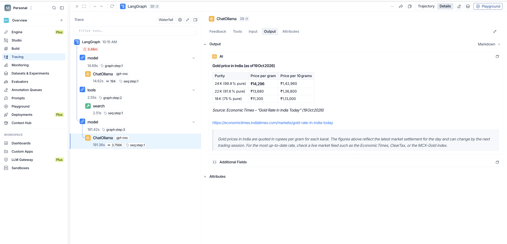

## LangChain Agent Learning

This branch contains my hands-on learning and experimentation with LangChain agents, custom tools, web search, and LangSmith tracing.

## Overview

The project covers two implementations:

1. Building a LangChain agent with a custom search tool.
2. Integrating Tavily Search with a LangChain agent.

LangSmith traces and screenshots are included to document and inspect the execution of both implementations.

## Technologies Used

- Python
- LangChain
- LangChain Ollama
- Tavily Search
- LangSmith
- uv

## Commit 1: practice LangChain agent with custom search tool

**Commit:** [View commit](https://github.com/manishaGuptaa/my-langchain-learning/commit/47b1c30827521c71faf0cb0fc23d183b991324df)

This implementation explores creating a LangChain agent with a custom search tool.

### Key Concepts

- Creating and using a custom tool.
- Connecting tools to an agent.
- Understanding agent execution through LangSmith.

### LangSmith Trace

**Screenshot**




**Trace JSON:** 
[trace-commit1.json](src/commit1/trace-commit1.json)

## Commit 2: integrate Tavily search tool with LangChain agent

**Commit:** [View commit](https://github.com/manishaGuptaa/my-langchain-learning/commit/4b427124ae30acfa8daf3707617715252b1a136b)

This implementation explores integrating Tavily Search with a LangChain agent to retrieve search results dynamically.

### Key Concepts

- Integrating an external search API.
- Using Tavily as an agent tool.
- Observing tool calls and execution through LangSmith.

### LangSmith Trace

**Screenshot**




**Trace JSON:** 
[trace-commit2.json](src/commit2/trace-commit2.json)

## LangSmith Observability

LangSmith helps inspect and debug agent execution by providing information about model calls, tool invocations, execution steps, and outputs.

The saved artifacts in this branch serve as a reference for understanding and comparing the two implementations.

**Note:** Exported JSON files and screenshots are saved project artifacts. They are separate from the live traces available in the LangSmith dashboard.

## Setup

### Prerequisites

- Python
- uv
- Ollama with the model used by the project
- Tavily API key for the Tavily integration

### Install Dependencies

If your project contains a `pyproject.toml` file, install the dependencies with:

```bash
uv sync
```

### Configure Environment Variables

Create a `.env` file and add the credentials required by your implementation.

```env
TAVILY_API_KEY=your_tavily_api_key
LANGSMITH_TRACING=true
LANGSMITH_API_KEY=your_langsmith_api_key
LANGSMITH_PROJECT=my-langchain-learning
```

Keep your `.env` file and API keys private. Do not upload secrets to GitHub.

## Learning Outcomes

- Building LangChain agents with tools.
- Integrating external search functionality.
- Understanding agent and tool execution.
- Inspecting runs using LangSmith.
- Saving trace JSON files and screenshots for documentation and future reference.
